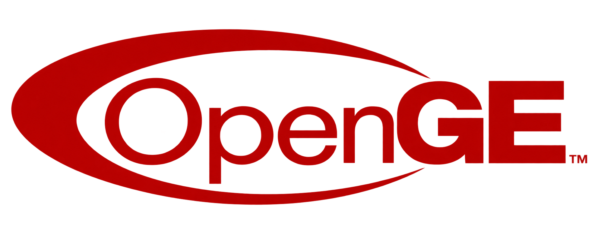

<p align="center">
  <a href="Assets/Wide.png">
    
  </a>
</p>

---

Mirage is an experimental 2D game engine for C# and .NET.

It is built around small systems that can be composed together while keeping their responsibilities separate. Mirage is currently developed alongside games at Stone Bogus and evolves as those projects need it.

> [!WARNING]
> Mirage is under active development. APIs and project structure may change.

## Features

- Hierarchical node system
- 2D spatial nodes and cameras
- Space-based rendering
- Shapes, textures, text, and meshes
- Keyboard and mouse input
- 2D physics and simulation spaces
- Resource importing and decoding
- Update scheduling
- Window management
- Reactive events and state
- Modular engine composition

## Example

A Mirage engine is assembled from modules.

```csharp
internal sealed class MyEngine : Engine
{
    public readonly MyWindowManager Windows;
    public readonly MyNodeManager Nodes;
    public readonly MyInputHandler Input;
    public readonly MySimulator Simulator;
    public readonly MyRenderer Renderer;
    public readonly MyScheduler Scheduler;

    public MyEngine()
    {
        Windows = new MyWindowManager();
        Nodes = new MyNodeManager();
        Simulator = new MySimulator();

        Renderer = new MyRenderer(
            Windows.Main,
            Nodes,
            Nodes.Main.Camera
        );

        Input = new MyInputHandler(Windows.Main);

        Scheduler = new MyScheduler(
            Windows,
            Input,
            Nodes,
            Simulator,
            Renderer
        );
    }

    protected override IEnumerable<Module> Compose()
    {
        yield return Windows;
        yield return Nodes;
        yield return Input;
        yield return Simulator;
        yield return Renderer;
        yield return Scheduler;
    }
}
```

The engine owns these modules and coordinates their lifecycle. Individual modules remain responsible for their own part of the engine.

## Nodes

Nodes represent the structure of a game.

```text
Main
├── Camera
├── Player
├── World
│   ├── Enemy
│   └── Enemy
└── UI
```

Nodes can compose other nodes and can be added or moved while the game is running.

```csharp
internal sealed class MyRoot : Node
{
    public readonly Camera Camera = new();
    public readonly Player Player = new();

    public MyRoot()
        : base("Main") { }

    protected override IEnumerable<Node> Compose()
    {
        yield return Camera;
        yield return Player;
    }
}
```

A `NodeManager` can expose selected module dependencies to its nodes. This allows game nodes to access systems they depend on without passing those systems through every constructor.

```csharp
internal sealed class Player() : SpatialNode("Player")
{
    private MyInputHandler Input =>
        Require<MyInputHandler>();

    protected override void Configure()
    {
        Input.Keyboard.MoveLeft.Connect(OnMoveLeft);
        Input.Keyboard.MoveRight.Connect(OnMoveRight);
    }
}
```

Dependencies available to nodes are explicitly selected by their `NodeManager`.

## Composition & Configuration

Mirage uses composition to declare owned objects and configuration to connect them after they have been composed.

`Compose()` defines the objects that belong to a system:

```csharp
protected override IEnumerable<InputDevice> Compose()
{
    yield return Keyboard;
    yield return Mouse;
}
```

`Configure()` can then connect behavior or establish relationships once those objects are available:

```csharp
protected override void Configure()
{
    Keyboard.Jump.Connect(OnJump);
}
```

`Mirage.Common.Primitives.Preparator` controls these phases throughout the engine:

```csharp
private readonly Preparator _preparator = new();

// ComposeContents registers the results of the object's Compose() hooks.
_preparator.Ensure(ComposeContents, Configure);
```

Composition completes before configuration, and each phase runs at most once. `State`
exposes the current `PreparationState`; `Prepared` becomes true after both phases succeed.
Reentrant preparation is rejected. If either phase throws, preparation permanently fails
and the original exception propagates. Startup failures after successful preparation do
not reset it, so later lifecycle cycles reuse the prepared contents.

Nodes use `EnsureComposed()` during dependency injection and finish preparation when
loaded. This preserves access to injected dependencies in `Configure()`. The preparator
controls ordering only: each owner still registers its contents and handles their cleanup.
It does not introduce preparation hooks into `Module` or replace startup and shutdown.

See [Preparation](Contributing/Preparation.md) for integration and failure rules.

## Architecture

Mirage is split into focused projects:

```text
Common
Graphics
Handling
Importing
Math
Noding
Physics
Rendering
Scheduling
Simulating
Spatial
Windowing
```

They cover different parts of the engine without requiring everything to belong to one large framework.

For example, the node hierarchy describes the game world, while rendering, input, physics, scheduling, and windowing remain separate systems.

## Philosophy

Mirage is a focused 2D engine.

It prefers small systems, explicit ownership, composition, and existing .NET types where they already solve a problem well.

The engine does not try to abstract every implementation detail or support every kind of game. Its architecture grows alongside the games being built with it.

## AI Usage

AI-assisted tools are used throughout Mirage's development for exploring ideas, reviewing and implementing code, finding inconsistencies, and maintaining documentation.

Architecture and design decisions remain with the maintainers. AI output is reviewed and may be modified or discarded.

Much of Mirage's API documentation is written or refined with AI assistance to maintain consistency across the codebase. This README and other project documentation may also use AI assistance.

Mirage is not generated as a whole by AI; AI is one of the tools used in its iterative development.

## Development

Active development takes place on the `develop` branch.

```bash
git checkout develop
```

> [!NOTE]
> Mirage is not stable yet. Documentation and examples may change as the engine develops.

## License

Mirage is licensed under the [MIT License](LICENSE).